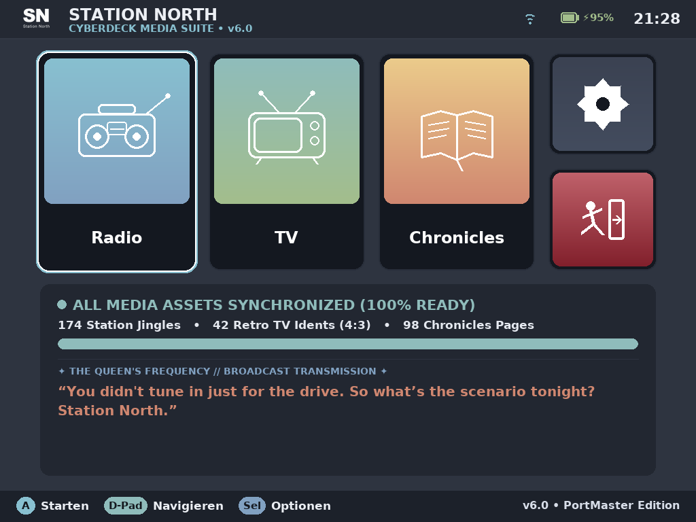
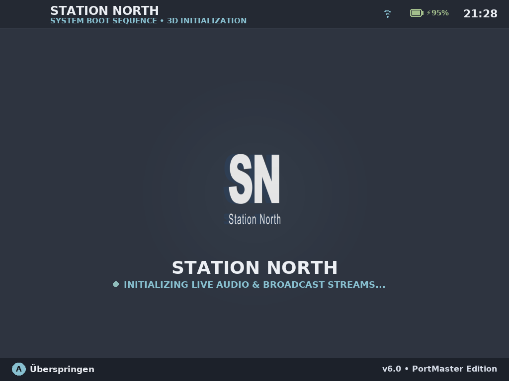
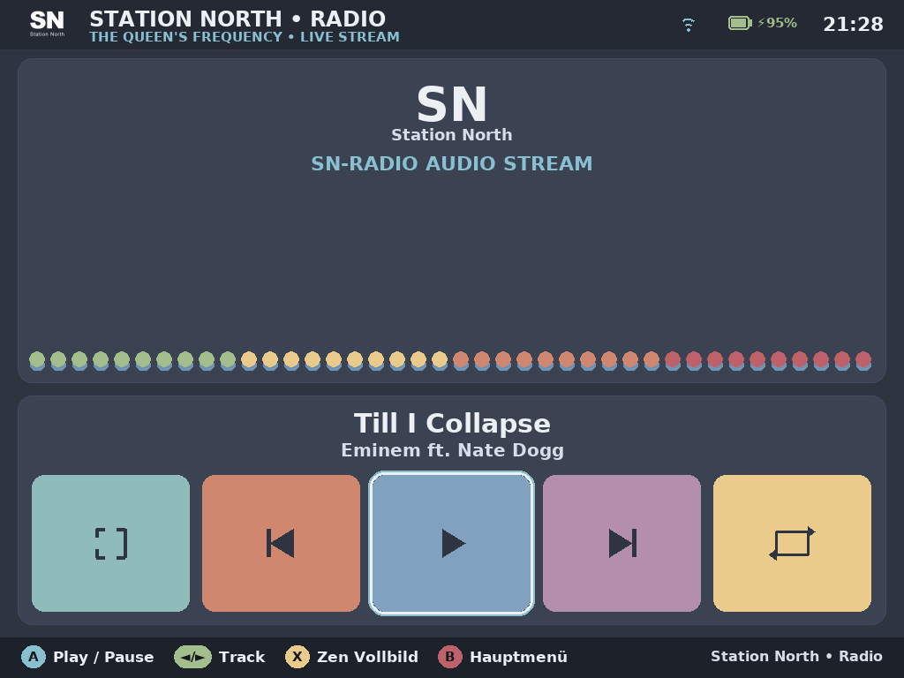
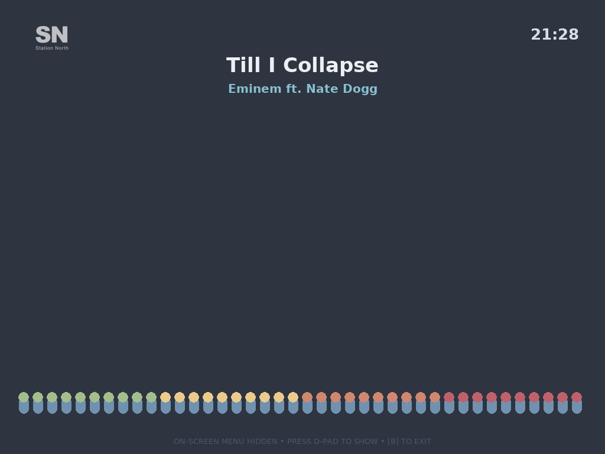
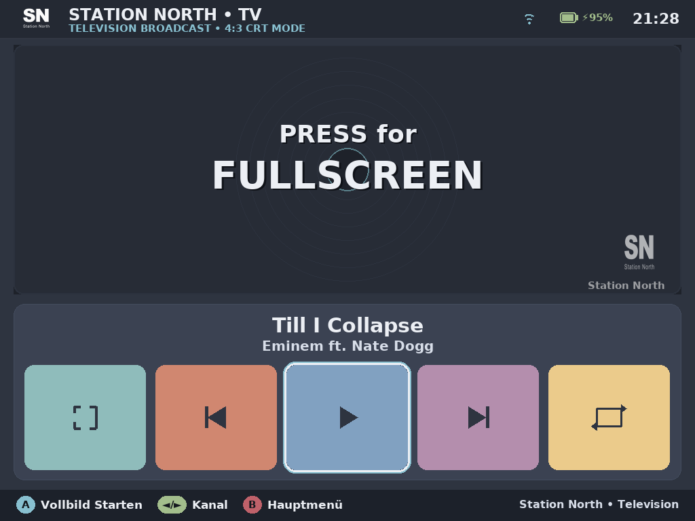
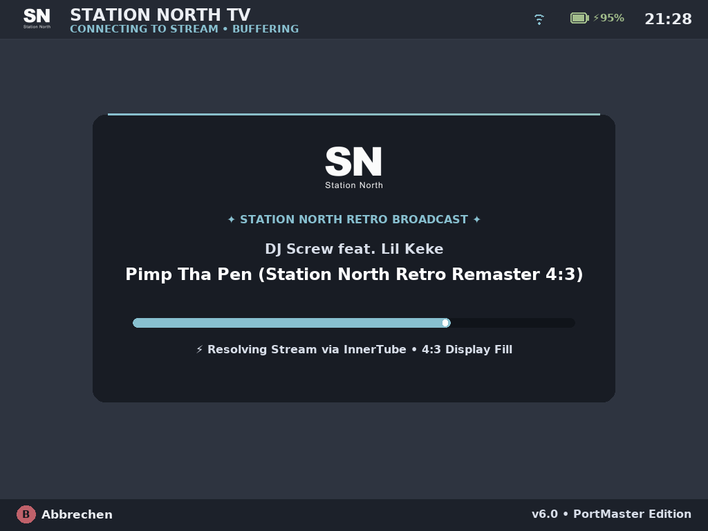
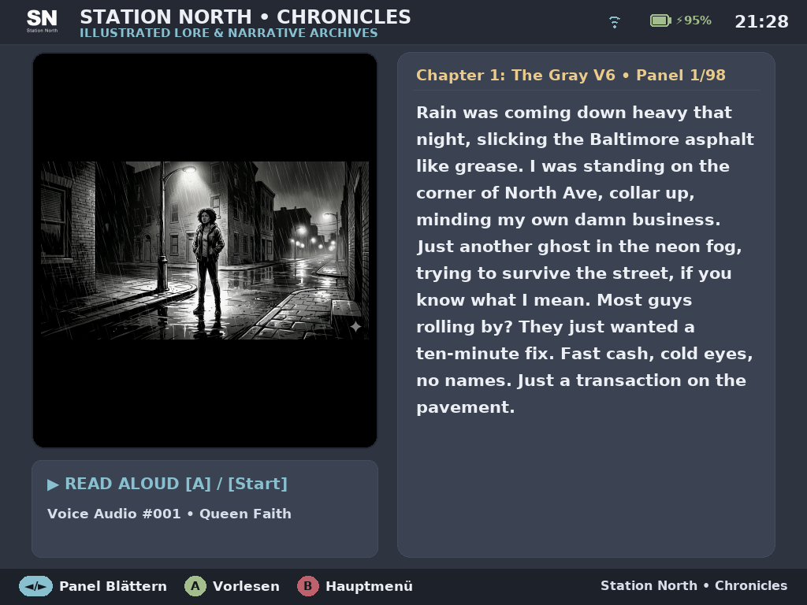
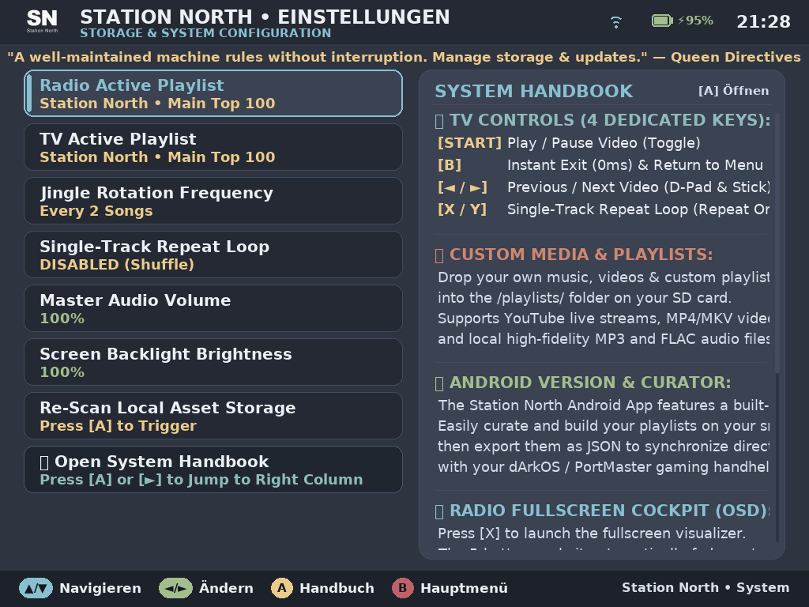

# 👑 Station North SNfetchPLAYER • PortMaster Edition (v6.2)

<p align="center">
  
</p>

<p align="center">
  <b>The Sovereign Cyberdeck & Retro Media Suite for Handheld Gaming Consoles</b><br>
  <i>Tailored for Rockchip RK3326, RK3566, Allwinner H700 & Amlogic Handhelds running ArkOS, dArkOS, AmberELEC, ROCKNIX & PortMaster</i>
</p>

<p align="center">
  <a href="#-quick-start--installation"></a>
  <a href="#-the-visual-experience"></a>
  <a href="#-words-from-the-queen-ready-to-share"></a>
</p>

---

## 🎙️ A Transmission from The Queen

> *"The lights are low, the bass is heavy. Are you alone tonight? Or did you bring company for the Queen?*  
> *I know exactly why you turned the volume up on that little handheld of yours. Don't fight it... settle into the velvet seats of the Manjaro Lounge. I provide the rhythm, you provide the friction. You’re locked into Station North."*  
> — **The Queen**, *Station North Frequency // On Air*

---

## 🌟 The Visual Tour

SNfetchPLAYER transforms your gaming handheld into an authentic, standalone late-night media terminal. Built in Python 3 and SDL2/Pygame with exclusive hardware KMSDRM acceleration, it runs at silky 60 FPS with zero desktop overhead.

### 1. The Command Deck • 3+2 Tile Matrix & Aurora Broadcasts

*Authentic Nord Aurora color palette with instant D-Pad matrix navigation. The lower sync card displays live asset statistics, high-speed download progress, and cycling quotes straight from **The Queen** in randomized Aurora hues.*

### 2. Holographic 3D Boot Sequence

*Dynamic Y-axis rotating metallic medallion with 3D depth extrusion, cool polar-night reverse shading, and ambient cyan radial glow. Smoothly docks into the top header upon startup. Press `[A]` to skip anytime.*

### 3. The Queen's Frequency • High-Definition Radio
<p align="center">
  
  
</p>

*Left: 2-Card Studio Stage with 40-band real-time audio visualizer, automatic gain control (AGC), 30px bold track typography, and chunky 5-button cockpit controls.*  
*Right: **Zen Fullscreen Mode** (`[X]`) for ambient desk listening with watermark clock and auto-hiding cockpit.*

### 4. Station North TV • 4:3 CRT Broadcast & Cyberdeck Buffer
<p align="center">
  
  
</p>

*Left: Live retro monitor view scaling music videos seamlessly to handheld 4:3 displays with ASS lower-third 'Bauchbinden' banners and retro station idents.*  
*Right: The redesigned **Broadcast Buffer Card** with channel badge, centered crest, and progress telemetry.*

### 5. The Chronicles & System Deck
<p align="center">
  
  
</p>

*Left: **The Chronicles** featuring deep-black canvas framing, original artwork, voiceover lore narration, and high-legibility 21px bold typography.*  
*Right: **System Settings & Interactive Handbook** with 20px readable labels, live catalog switching, jingle rotation interval, and on-device manual.*

---

## 🎮 Controller Layout & Keybindings

Universal PortMaster controller bindings with hardware debounce and anti-slip filtering:

| Button | Main Menu (Command Deck) | Radio Cockpit | Zen Mode (Fullscreen) | TV Broadcast | The Chronicles | Settings & Handbook |
|---|---|---|---|---|---|---|
| **`[A]`** | Start Focused Card | Select / Execute | Wake OSD | Fullscreen Video | Play/Pause Voiceover | Open Handbook / Select |
| **`[B]`** | *(Safe: No Exit)* | Return to Menu | Return to Stage | **Instant Exit (0ms)** | Return to Menu | Back / Close Handbook |
| **`[◄]` / `[►]`** | Navigate Cards | Prev / Next Track | Prev / Next Track | Prev / Next Video | Turn Comic Page | Change Value / Switch Col |
| **`[▲]` / `[▼]`** | Navigate Cards | – | – | – | – | Select Row / Scroll Book |
| **`[X]`** | – | Zen Fullscreen Mode | Toggle OSD | Repeat Single Track | – | Focus Handbook |
| **`[Y]`** | – | Repeat Track Loop | Repeat Track Loop | Repeat Single Track | – | Toggle Repeat Loop |
| **`[SELECT]`** | Quick Settings | Quick Settings | Wake OSD | – | Quick Settings | Close Settings |
| **`[START]`** | Launch Focused | Play / Pause | Play / Pause | Freeze / Play | – | Apply Action |
| **`[SEL] + [START]`** | **PortMaster Emergency Exit** | **Emergency Exit** | **Emergency Exit** | **Emergency Exit** | **Emergency Exit** | **Emergency Exit** |

> [!NOTE]  
> In the Main Menu, pressing `[B]` is safely locked against accidental app termination. Clean exit to EmulationStation is handled exclusively by selecting the red **#4 Exit Tile** and pressing `[A]`.

---

## 📦 Quick Start & Installation

We provide two installation flavors to fit your handheld setup:

### Option 1: Lightweight Online Package (`snfetchplayer.zip` ~128 KB)
*Recommended for Wi-Fi enabled handhelds.*
1. Download `snfetchplayer.zip` from [GitHub Releases](https://github.com/StationNorthMedia/SNfetchPLAYER-PortMaster/releases).
2. Extract the archive directly into your SD card's `ports/` directory:
   ```text
   /roms/ports/
   ├── SNfetchPLAYER.sh
   └── snfetchplayer/
   ```
3. Boot your device, connect to Wi-Fi, and launch **Station North SNfetchPLAYER** from the **Ports** menu.
4. On first launch, the built-in **High-Speed Asset Downloader** will automatically download and unpack the full 285 MB media bundle (jingles, TV idents, comics) in seconds.

### Option 2: Full Offline Bundle (`snfetchplayer-full.zip` ~285 MB)
*Recommended for offline devices or zero-setup plug-and-play.*
1. Download `snfetchplayer-full.zip` from [GitHub Releases](https://github.com/StationNorthMedia/SNfetchPLAYER-PortMaster/releases).
2. Extract directly to `/roms/ports/` on your SD card.
3. Plug into your device and play immediately with zero downloads required!

---

## 📁 Custom Playlists & Curator Integration

Want to play your own music collection alongside The Queen's curated sets?
Drop your MP3, FLAC, M4A, or JSON playlists directly into:
```text
/roms/ports/snfetchplayer/playlists/
```
Navigate to **Settings -> Re-Scan Local Asset Storage** and your custom stations will be indexed instantly. You can also build playlists in the **Station North Android App**, export them as JSON, and sync them over!

---

## 📢 Words from The Queen (Ready to Share!)

Love the app? Want to spread the word on Reddit, Discord, or Twitter?  
Here are ready-to-copy promo snippets in The Queen's signature voice. Just copy, paste, and add the link!

### 💬 1. For Reddit (`r/SBCGaming`, `r/RetroHandhelds`, `r/PortMaster`)

```markdown
**Title:** Turn your retro handheld into a sultry late-night Cyberdeck — Station North SNfetchPLAYER v6.2 (PortMaster / ArkOS / AmberELEC)

Hey everyone,

If you love using your retro handheld (RG351, RGB30, TrimUI, Miyoo, Anbernic RK3326/RK3566/H700) as more than just a rom machine, check out **Station North SNfetchPLAYER**.

It’s a standalone, native 60 FPS Cyberdeck media terminal built from scratch for PortMaster:

📻 **The Queen's Frequency (Radio Mode)**: Real-time 40-band AGC spectrum analyzer, curated R&B/Hip-Hop/Soul radio, and an ambient fullscreen Zen Mode with auto-hiding OSD.
📺 **Retro TV Broadcast**: Music videos perfectly formatted for 4:3 handheld screens, authentic broadcast lower-third banners, and retro station ident commercials.
📖 **The Chronicles**: Voice-narrated cyber-lore comics with crisp, boosted typography optimized specifically for 3.5" handheld displays.
⚙️ **In-App Media Sync**: Fast automated downloading of station media packages, or fully offline 285MB drag-and-drop bundle.
🎨 **Nord Aurora Aesthetics**: 3D holographic coin-spin logo boot sequence, snappy lerp cursor, and randomized late-night radio quotes.

Check out the GitHub repo and grab the release for your handheld:
👉 https://github.com/StationNorthMedia/SNfetchPLAYER-PortMaster

*"The lights are low, the bass is heavy. Settle in... the Queen is broadcasting."*
```

---

### 🐦 2. For Twitter / X / Threads

```text
Turn your retro handheld into a sleek late-night Cyberdeck 📻✨

Station North SNfetchPLAYER v6.2 is out on PortMaster!
• 40-Band Realtime Spectrum Visualizer
• 4:3 Music Video Broadcasts with Retro Banners
• Voiceover Lore Comics
• Nord Aurora Cyberpunk UI

Download free 👉 https://github.com/StationNorthMedia/SNfetchPLAYER-PortMaster

#SBCGaming #PortMaster #RetroHandheld #ArkOS #IndieDev
```

---

### 🎙️ 3. For Discord & Retro Communities

```text
👑 **Station North SNfetchPLAYER v6.2 • PortMaster Edition** 👑
*"Whatever you’re doing right now... do it slower. I set the tempo on this frequency."*

Turn your RK3326 / RK3566 handheld into a portable late-night media suite:
⚡ 60 FPS native KMSDRM UI with Nord Aurora 3+2 Tile Matrix
📻 Cyberdeck Live Radio with 40-band dynamic AGC visualizer
📺 4:3 Retro CRT Music Video Player with broadcast lower-thirds
📖 The Chronicles voiced lore comic book
⚡ Full offline plug-and-play bundle + In-app fast asset sync

👉 Grab the ZIP here: https://github.com/StationNorthMedia/SNfetchPLAYER-PortMaster
```

---

## 🛠️ Technical Specifications

- **Display Pipeline**: Pygame 2.6 on Linux KMSDRM DirectFB (`/dev/dri/card0`) with sub-pixel hardware V-Sync.
- **Audio/Video Stream Processing**: Headless InnerTube dynamic stream resolver coupled with low-latency `ffplay` audio/video pipeline and libass subtitle renderer.
- **Spectrum Analysis**: 40-band software FFT analyzer with logarithmic binning, pink-noise slope compensation, and peak falloff decay.
- **Packaging**: Standard PortMaster specification (`port.json`, `gameinfo.xml`, `snfetchplayer.gptk`).

---

## 📄 License & Legal

- **Code**: MIT License © Station North Media
- **Audio Jingles, Artwork & Lore**: © Station North Media. All rights reserved.
